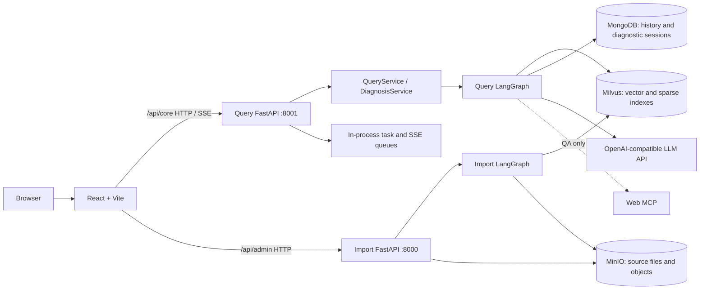

# PrintCare AI

[简体中文](README.md) | English

An AI-powered full-stack technical-support platform for desktop 3D-printer users. PrintCare AI currently focuses on the **Creality K1**: users can ask source-backed questions or follow a multi-turn diagnostic flow constrained by local documentation.

`React` · `FastAPI` · `LangGraph` · `Milvus` · `MongoDB` · `MinIO`

> This project is a secondary development based on the public course project *Zhanggui Knowledge Base*. It reuses parts of the existing RAG and ingestion capabilities while adding the K1-oriented frontend, diagnostic sessions, and safety constraints. Existing course code must not be represented as wholly original work.

## 1. Project Overview

Desktop 3D-printing support information is often spread across manuals, troubleshooting experience, and web sources. PrintCare AI imports authorized K1 documentation into a knowledge base and provides two explicit entry points:

- **Knowledge Q&A**: answers usage and common troubleshooting questions, showing the local or web sources that actually entered the answer context.
- **Intelligent Diagnosis**: asks follow-up questions dynamically, for up to three rounds, and produces recommendations only when trusted local K1 evidence supports them; otherwise it safely returns `insufficient`.

V1 does not connect to a physical printer or send device-control commands. An AI recommendation does not mean a repair has been completed.

## 2. Product Preview

> Screenshots to be added: this repository does not currently contain reusable public product screenshots. Add sanitized screenshots of the workspace, Q&A, diagnostic questions/results, history, and knowledge-base administration under `docs/assets/`, then replace this notice with the real images.

The current React single-page application includes five routes: workspace (`/`), Knowledge Q&A (`/qa`), Intelligent Diagnosis (`/diagnosis`), History (`/history`), and Knowledge Base Management (`/admin`).

## 3. Core Features

| Capability | User need | Current implementation |
| --- | --- | --- |
| Knowledge Q&A | Quickly consult K1 usage and troubleshooting material | Hybrid retrieval, HyDE, RRF, reranking, and streaming answers. The controlled QA path may use Web MCP and labels local and web sources separately. |
| Intelligent Diagnosis | Turn an ambiguous fault description into answerable checks | LangGraph dynamically creates one to three independent questions; supports batch answers, uncertain/other options, early completion, and up to three clarification rounds. |
| Evidence and device constraints | Avoid using unsupported devices or unsupported advice in diagnostics | The server constrains requests to `creality-k1`; diagnosis accepts only local evidence actually retrieved in the current run and validates citations, device ownership, and risky operations. |
| Sessions and history | Review or continue prior work | MongoDB stores Q&A history plus diagnostic rounds, states, citations, and feedback; diagnosis uses idempotent requests, revision-based optimistic locking, and inference leases. |
| Knowledge-base management | Bring controlled material into retrieval | API-key-protected PDF/Markdown upload; an ingestion graph processes, chunks, embeds, and writes K1 collections. |

## 4. Technical Architecture



In the verified controlled environment, React/Vite and the two FastAPI services run on the Windows host. MongoDB, Milvus, MinIO, etcd, and Attu run through Docker Compose in a Linux VM. For component responsibilities, data flow, and runtime boundaries, see [System Architecture and Module Responsibilities](docs/T4-03-01-系统架构与模块职责.md).

## 5. Core Technical Design

- **Server-side K1 retrieval constraints**: `resolve_supported_device` and Milvus filters scope retrieval before recall; diagnosis does not rely solely on page parameters or prompts for device validation.
- **One RAG pipeline, two controlled paths**: QA and Diagnosis share retrieval and `reranked_docs`; only QA may schedule Web MCP, while the Diagnosis code path blocks network retrieval.
- **Hybrid recall and reranking**: local dense/sparse retrieval, a HyDE branch, RRF fusion, and a reranker produce candidates; answers expose only sources that entered the context.
- **Dynamic diagnosis with evidence validation**: the LLM produces structured `ask` / `answer` / `insufficient` candidates, then code validates question counts, repeated questions, citations, device ownership, and recommendation safety.
- **Session consistency**: diagnostic `request_id`, revision-conditional updates, and inference leases address duplicate submissions, stale-page writes, and concurrent inference; MongoDB is the persistent source of truth across refreshes.
- **Separated real-time transport and persistence**: SSE carries progress and results for the current process; Q&A history and diagnostic sessions are stored in MongoDB and restored through their respective paths.

For code-level execution details, see [Q&A Request Execution](docs/T4-03-02-QA请求执行链.md), [Diagnosis Request Execution](docs/T4-03-03-Diagnosis请求执行链.md), and [Technical Design and Trade-offs](docs/T4-03-04-关键技术设计与取舍.md).

## 6. Quick Start

Before running the project, prepare Python 3.10, Node.js 22+, reachable MongoDB/Milvus/MinIO services, an OpenAI-compatible model service, and local BGE-M3/Reranker model directories. Copy `knowledge/.env.example` to the locally ignored `knowledge/.env` and fill it with your own secure configuration; optional frontend proxy settings are in `frontend/.env.example`.

The infrastructure follows the existing Linux-VM Compose topology. Read the [Infrastructure Configuration Guide](docs/T4-02-02C-基础设施配置说明.md) first, and configure a controlled development environment with the credential-free [Compose example](docs/docker-compose.example.yml). Starting containers does not create K1 collections or import knowledge documents.

```powershell
# Install frontend dependencies
Set-Location G:\codex-work\PrintCare\frontend
npm ci

# Create a backend virtual environment and install dependencies
# A clean-environment installation has not yet been fully verified.
Set-Location G:\codex-work\PrintCare\knowledge
py -3.10 -m venv .venv
.\.venv\Scripts\python.exe -m pip install -r requirements.txt
```

Start the query service, import service, and frontend in three PowerShell windows:

```powershell
# From the repository root: query service
.\knowledge\.venv\Scripts\python.exe -m uvicorn knowledge.api.query_router:create_app --host 127.0.0.1 --port 8001

# From the repository root: import service
.\knowledge\.venv\Scripts\python.exe -m uvicorn knowledge.api.import_router:create_app --host 127.0.0.1 --port 8000

# From frontend/: Vite
npm run dev -- --host 127.0.0.1 --port 5174
```

See the [Local Run Guide](docs/T4-02-01-本地运行说明.md) for variables, K1 collection/data initialization prerequisites, health checks, shutdown, and common issues.

## 7. Testing and Validation

Documented regression results include passing `npm run lint`, `npm test`, and `npm run build` for the frontend (8 test files, 32 tests), plus `python -m unittest discover -s knowledge\test -p "test_*.py"` for the backend (136 passed, 1 skipped). Commands and runtime scope are recorded in [T4-02-03 Minimal Runtime Verification](docs/T4-02-03-最小运行验证.md).

Controlled-environment validation also records K1 Q&A, authenticated Admin upload, a 409 stale-revision conflict, and idempotency for the same `request_id`. The earlier [T2-07 Real-World Acceptance](docs/T2-07-真实业务验收.md) included a real `answer → pending_verification → resolved/unresolved` flow. The current [T3-03-06 End-to-End Acceptance](docs/T3-03-06-端到端验收.md) did not obtain a new `answer` for that frontend regression and did not verify recovery from a physical interruption of an active SSE stream. These automated and historical results must not be overstated as complete end-to-end acceptance for the current version.
