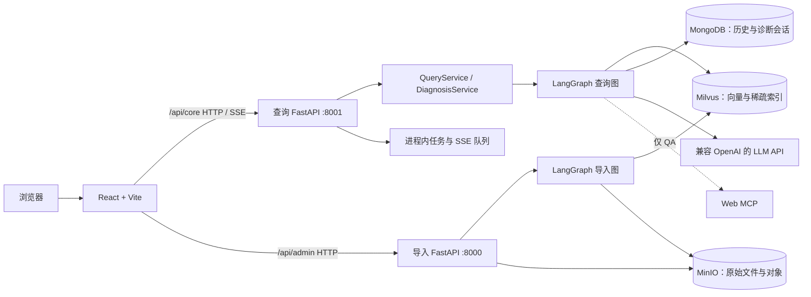

# PrintCare AI

[English](README.en.md) | 简体中文

面向桌面级 3D 打印机用户的 AI 全栈技术支持平台。PrintCare AI 当前聚焦 **Creality K1**：用户可在知识问答中获取带来源的说明，也可在智能诊断中通过多轮澄清获得受本地资料约束的建议。

`React` · `FastAPI` · `LangGraph` · `Milvus` · `MongoDB` · `MinIO`

> 本项目基于公开课程项目「掌柜智库」进行二次开发；保留并复用其部分 RAG 与导入能力，在此基础上实现面向 K1 的前端、诊断会话和安全约束。请勿将课程既有代码表述为完全自主原创。

## 1. 项目介绍

桌面级 3D 打印的支持信息通常分散在手册、排障经验和网页资料中。PrintCare AI 将已授权的 K1 本地资料导入知识库，为两类不同的需求提供入口：

- **知识问答**：回答使用说明和常见问题，展示实际进入回答上下文的本地或网页来源。
- **智能诊断**：围绕用户描述动态追问，最多三轮；只有当前 K1 的本地可信证据能支撑结论，资料不足时会保守地返回 `insufficient`。

V1 不连接真实打印机、不发送设备控制命令，AI 建议不等同于已完成维修。

## 2. 项目预览

> 截图待补：当前仓库未保存可公开复用的产品截图。建议补充工作台、QA 对话、诊断追问/结论、历史记录和知识库管理各一张脱敏截图后，在此处以 `docs/assets/` 中的真实图片替换本提示。

当前 React 单页应用已提供五个页面：工作台（`/`）、知识问答（`/qa`）、智能诊断（`/diagnosis`）、历史记录（`/history`）和知识库管理（`/admin`）。

## 3. 核心功能

| 能力 | 面向的问题 | 当前实现 |
| --- | --- | --- |
| 知识问答 | 快速查询 K1 使用与排障资料 | 混合检索、HyDE、RRF、重排序与流式回答；QA 可在受控分支引入 Web MCP，并区分本地/网页来源。 |
| 智能诊断 | 将模糊故障描述转化为可回答的排查问题 | LangGraph 动态生成 1–3 个独立问题；支持批量作答、不确定/其他选项、提前结束和最多三轮澄清。 |
| 证据与设备约束 | 避免把其他型号或无依据内容用于诊断 | 服务端限定 `creality-k1`；诊断只接受本轮实际命中的本地证据，并校验引用、设备归属与危险操作。 |
| 会话与历史 | 支持回看与继续处理 | MongoDB 保存 QA 历史及诊断轮次、状态、引用和反馈；诊断使用请求幂等、revision 乐观锁和推理租约。 |
| 知识库管理 | 将受控资料纳入检索范围 | 管理密钥保护的 PDF/Markdown 上传；导入图处理、切分、向量化并写入 K1 Collection。 |

## 4. 技术架构



在已验证的受控环境中，React/Vite 和两个 FastAPI 服务运行在 Windows 宿主机；MongoDB、Milvus、MinIO 及 etcd、Attu 运行在 Linux 虚拟机的 Docker Compose 中。更完整的职责、数据流和运行边界见 [系统架构与模块职责](docs/T4-03-01-系统架构与模块职责.md)。

## 5. 核心技术设计

- **K1 服务端检索约束**：`resolve_supported_device` 和 Milvus 过滤在召回前限定设备归属；诊断不以页面参数或模型提示词代替服务端校验。
- **一套 RAG、两条受控路径**：QA 与 Diagnosis 复用检索和 `reranked_docs`；仅 QA 可调度 Web MCP，Diagnosis 在程序路径上阻断网络检索。
- **混合召回与重排序**：本地稠密/稀疏检索、HyDE 分支、RRF 融合和 Reranker 共同产出候选；答案只展示实际进入上下文的来源。
- **动态诊断与证据校验**：LLM 产生结构化 `ask` / `answer` / `insufficient` 候选，随后由程序校验题目数量、重复追问、证据引用、设备归属和建议安全性。
- **会话一致性**：诊断的 `request_id`、revision 条件更新和推理租约分别处理重复提交、旧页面写入与并发推理；MongoDB 是跨刷新会话的持久真相源。
- **实时传输与持久化分离**：SSE 只传递当前进程的进度和结果；QA 历史与诊断会话写入 MongoDB，前端可按各自机制恢复。

代码级执行过程见 [QA 请求执行链](docs/T4-03-02-QA请求执行链.md)、[Diagnosis 请求执行链](docs/T4-03-03-Diagnosis请求执行链.md) 和 [关键技术设计与取舍](docs/T4-03-04-关键技术设计与取舍.md)。

## 6. 快速开始

运行前需要 Python 3.10、Node.js 22+、可访问的 MongoDB/Milvus/MinIO、兼容 OpenAI 的模型服务，以及本地 BGE-M3/Reranker 模型目录。复制 `knowledge/.env.example` 为本机忽略的 `knowledge/.env`，仅填写自己的安全配置；前端代理可选配置在 `frontend/.env.example`。

基础设施采用现有 Linux VM Compose 拓扑。请先阅读 [基础设施配置说明](docs/T4-02-02C-基础设施配置说明.md)，使用无密钥的 [Compose 示例](docs/docker-compose.example.yml) 配置受控开发环境；容器启动不等于已创建 K1 Collection 或已导入知识资料。

```powershell
# 安装前端依赖
Set-Location G:\codex-work\PrintCare\frontend
npm ci

# 创建后端虚拟环境并安装依赖（干净环境尚未完整验证）
Set-Location G:\codex-work\PrintCare\knowledge
py -3.10 -m venv .venv
.\.venv\Scripts\python.exe -m pip install -r requirements.txt
```

在三个 PowerShell 窗口分别启动查询服务、导入服务和前端：

```powershell
# 从仓库根目录启动查询服务
.\knowledge\.venv\Scripts\python.exe -m uvicorn knowledge.api.query_router:create_app --host 127.0.0.1 --port 8001

# 从仓库根目录启动导入服务
.\knowledge\.venv\Scripts\python.exe -m uvicorn knowledge.api.import_router:create_app --host 127.0.0.1 --port 8000

# 从 frontend 目录启动 Vite
npm run dev -- --host 127.0.0.1 --port 5174
```

完整的变量说明、K1 Collection/资料初始化前置条件、健康检查、停止方式和常见问题见 [本地运行说明](docs/T4-02-01-本地运行说明.md)。

## 7. 测试与验证

已记录的回归结果包括：前端 `npm run lint`、`npm test`、`npm run build` 通过（8 个测试文件、32 个测试）；后端 `python -m unittest discover -s knowledge\test -p "test_*.py"` 通过（136 passed、1 skipped）。详细命令与运行边界见 [T4-02-03 最小运行验证](docs/T4-02-03-最小运行验证.md)。

真实受控环境的验收还记录了 K1 QA、Admin 鉴权上传、旧 revision 的 409 冲突以及相同 `request_id` 幂等。较早的 [T2-07 真实业务验收](docs/T2-07-真实业务验收.md) 曾覆盖真实 `answer → pending_verification → resolved/unresolved`；当前 [T3-03-06 端到端验收](docs/T3-03-06-端到端验收.md) 未取得可用于该前端回归的新的 `answer`，且未完成活跃 SSE 物理断连恢复验收。因此，上述自动化和历史结果不应扩大为当前版本的完整端到端通过结论。
