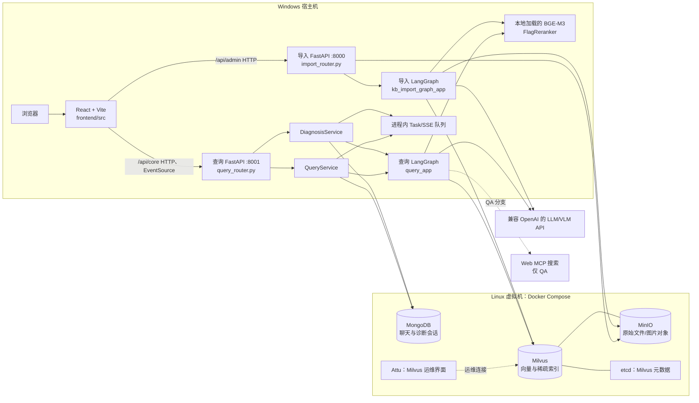

# T4-03-01 系统架构与模块职责

> 盘点日期：2026-10-13。本文依据当前源码及 T4-02 已核对的现有运行拓扑编写；未启动服务、未调用模型。它描述“代码现在如何协作”，不以早期 To-Be 设计推定实现状态。

## 1. 系统整体架构

当前前端是一个 React/Vite 单页应用，页面入口在 `frontend/src/app/routes.tsx`：工作台、知识问答、智能诊断、历史记录和知识库管理分别对应 `/`、`/qa`、`/diagnosis`、`/history`、`/admin`。浏览器通过 Vite 的 `/api/core` 与 `/api/admin` 代理访问两个独立 FastAPI 服务；前端的请求和 SSE 连接均封装在 `frontend/src/services/`，页面不直接硬编码后端地址。

按已验证的受控环境，React/Vite、查询服务和导入服务运行在 Windows 宿主机；MongoDB、Milvus、MinIO 及其 Compose 依赖运行在 Linux 虚拟机。LLM/VLM 和 Web MCP 是 Windows 服务主动调用的外部服务，不在该 Compose 内。

图中的进程内任务表和 SSE 队列只承担当前进程的进度传递，不能替代数据库持久化。`knowledge/utils/task_util.py` 和 `knowledge/utils/sse_util.py` 均为内存实现；刷新或服务重启后的 QA/Diagnosis 恢复分别依赖 MongoDB 中的历史或诊断会话。

## 2. 核心模块职责与源码导航

| 位置 | 当前职责与关键入口 | 主要协作对象 |
| --- | --- | --- |
| `frontend/src/` | React 应用。`main.tsx` 挂载 `App`，`app/routes.tsx` 定义五个页面；`services/http.ts` 统一 HTTP，`services/printcare-api.ts` 提供类型化业务 API，`services/sse.ts` 用 `EventSource` 消费 `progress`、`delta`、`diagnosis`、`final`、`error` 事件并有 30 秒无事件回收。 | Vite 代理、两个 FastAPI 服务；页面经服务层读取/提交状态。 |
| `knowledge/api/` | HTTP 边界。`query_router.py:create_app`/`register_routers` 注册 QA、诊断、历史与 SSE 路由；`import_router.py:create_app`/`register_router` 注册上传和导入状态，并由 `require_admin_access` 校验管理密钥。 | `knowledge/core/deps.py` 提供服务单例；请求/响应模型；FastAPI `BackgroundTasks`、SSE 生成器。 |
| `knowledge/services/` | 用例层。`query_service.py:QueryService.run_query_graph` 执行共用查询图并维护 QA 任务/历史；`diagnosis_service.py:DiagnosisService` 负责诊断会话、幂等/租约、持久化与结果推送；`import_file_service.py:ImportFileService.process_upload_file` 和 `run_import_graph` 负责接收文件并运行导入图。 | LangGraph、Mongo/Milvus/MinIO 辅助类、SSE/任务工具。 |
| `knowledge/schema/` | FastAPI 与工作流的结构化契约。`query_schema.py:QueryRequest` 区分 `qa`/`diagnosis`；`diagnosis_schema.py` 定义 `ask`、`answer`、`insufficient` 及反馈结构；另有上传和任务响应模型。 | 路由验证输入输出；诊断决策节点的 Pydantic 结构化结果。 |
| `knowledge/processor/query_process/` | QA 与诊断共用的检索编排。`main_graph.py:create_query_graph` 构造 `query_app`；向量、HyDE、RRF、重排后，QA 进入 `answer_output.py:AnswerOutputNode.process`，诊断进入 `diagnosis_decision.py:DiagnosisDecisionNode.process` 与 `diagnosis_validation.py:DiagnosisValidationNode.process`。 | `QueryService`/`DiagnosisService` 提供状态；Milvus、模型客户端、QA 专用 Web MCP、SSE/Mongo。 |
| `knowledge/processor/import_process/` | 文档导入编排。`main_graph.py:create_import_graph` 构造 `kb_import_graph_app`；PDF/Markdown 入口经图片处理、切分、设备识别、BGE 向量化，最后由 `nodes/import_milvus.py:ImportMilvusNode` 入 Milvus。 | `ImportFileService`、MinerU、LLM/VLM、MinIO、Milvus。 |
| `knowledge/utils/` | 基础设施适配与横切能力。`client/ai_clients.py:AIClients` 管理 LLM、BGE-M3、Reranker 客户端；`client/storage_clients.py:StorageClients` 管理 Mongo/Milvus/MinIO；`milvus_util.py` 执行混合检索；`mongo_history_util.py` 保存 QA 历史；`diagnosis_session_util.py:DiagnosisSessionRepository` 保存诊断会话；`sse_util.py` 和 `task_util.py` 提供进程内事件/任务状态。 | 服务层、工作流节点及外部基础设施。 |

设备限制并不只存在于页面：`knowledge/core/devices.py:resolve_supported_device` 当前只接受 V1 的 `creality-k1`，导入和查询服务都会使用该服务端校验结果。

## 3. 四条主要业务流程

### QA：提问、检索、流式回答与历史

1. `QaPage.tsx` 调用 `printCareApi.submitQuery`，流式请求随后由 `subscribeToTask` 订阅 `/api/core/stream/{task_id}`。
2. `query_router.py` 将 QA 交给 `QueryService.run_query_graph`；图先确认/改写查询，再并行执行本地向量检索、HyDE 检索和 Web MCP 搜索。
3. `RrfNode` 融合两个本地检索分支，`RerankNode` 将本地结果和 QA 的网页结果重排；`AnswerOutputNode` 调用 LLM，输出增量 SSE、最终事件及来源。
4. `AnswerOutputNode._write_history` 通过 `mongo_history_util.py` 写入以访客 ID 隔离的 QA 历史。前端同时以浏览器本地索引记录当前浏览器可见的会话入口。

### Diagnosis：受控本地证据、会话与反馈

1. `DiagnosisPage.tsx` 以 `mode: "diagnosis"` 创建或续接诊断，并在批量作答、结束及反馈时调用诊断 API。
2. `DiagnosisService` 用 `DiagnosisSessionRepository` 读取/锁定会话；`DiagnosisContextAssembler` 将原始问题、当前设备和已确认答案组成检索上下文。
3. 查询图在 diagnosis 模式只走向量与 HyDE 本地检索，`WebSearchMcpNode` 会在创建 Web 客户端前直接返回；重排后由诊断决策节点生成结构化候选，验证节点以本轮实际本地命中的证据、设备归属和安全约束校验。
4. 服务层持久化 `ask` 轮次或 `answer`/`insufficient` 终态，并经 SSE 推送；用户通过 HTTP 提交 `resolved`/`unresolved` 反馈。`docs/T2-07-真实业务验收.md` 记录过较早基线的真实成功结论到反馈闭环；但当前 T3 基线未取得新的可验证 `answer`，故当前版本的前端回归仍是留存缺口，不能据此视为已完成端到端验收。

### Admin：上传、导入与向量入库

1. `AdminPage.tsx` 将仅驻留内存的管理密钥随上传/状态请求发送；`import_router.py:require_admin_access` 在服务端拒绝未配置、缺失或错误的密钥。
2. `ImportFileService.process_upload_file` 校验设备与文件，创建导入任务，并尝试把原文件上传到 MinIO；后台随后运行 `run_import_graph`。
3. 导入图按文件类型处理 PDF 或 Markdown，生成/整理文本和图片说明、切分块、附加经服务端确认的设备归属，生成稠密/稀疏向量后写入 Milvus。
4. 管理端可轮询导入任务状态；当前没有可供前端调用的文档列表或删除 API，`frontend/src/components/admin/DocumentList.tsx` 明确保持为空状态而不伪造数据。

### History：两类持久化记录的读取

1. QA 历史由 `/api/core/history/{session_id}` 从 `chat_message` 读取，路由以 Cookie 或 `X-Visitor-ID` 限制访问；前端从本地存储的会话索引逐一取回并展示。
2. Diagnosis 列表与详情由 `/api/core/diagnoses` 和 `/api/core/diagnoses/{diagnosis_id}` 从 `diagnosis_session` 读取，同样按访客 ID 隔离；反馈、结束和删除也走相同会话边界。
3. 因此 History 页面不是统一的全站历史搜索：QA 的可发现性仍依赖浏览器本地会话索引，而诊断列表由后端会话库提供。

## 4. 存储、实时通信与信任边界

| 组件 | 当前保存/处理的内容 | 不承担的职责 |
| --- | --- | --- |
| Milvus | 导入后文本块及其稠密/稀疏向量；查询图的混合检索与重排前候选。`milvus_util.py:item_names_filter` 同时按 `device_id` 和设备名称过滤。 | 不保存聊天、诊断轮次或 SSE 任务状态。 |
| MongoDB | QA `chat_message` 历史；诊断 `diagnosis_session` 的轮次、状态、请求幂等信息、引用与反馈。 | 不负责向量相似度搜索或文件对象存储。 |
| MinIO | 导入原始文件、图片等对象；Milvus 在现有 Compose 拓扑中也使用对象存储。 | 不替代 Mongo 会话或 Milvus 索引。 |
| LangGraph | 将检索、模型调用、重排、答案/诊断决策或导入节点按图编排。 | 不作为跨请求持久状态：API/服务层负责鉴权、会话、后台任务和 HTTP/SSE 协议。 |
| SSE | 从进程内队列向浏览器单向推送 QA 文本增量、进度及诊断结构化结果。 | 不接收用户选择、不保证重启后补发；用户答题和反馈均为 HTTP POST。 |

QA 可使用可信本地资料和 Web MCP 返回的网页资料，`RerankNode` 会为两类来源分别构建元数据；Diagnosis 的程序路径明确排除 Web MCP，并由 `build_trusted_evidence` 仅接受当前设备归属的本地证据。该隔离是当前代码实现，不应仅依赖模型提示词理解。

## 5. 已有能力、边界与后续阅读入口

- 已有：五页面前端、两个 FastAPI 服务、QA 流式输出与来源、诊断结构化状态/会话/反馈 API、设备归属的本地检索约束、管理上传和导入图。
- 非本轮结论：没有通过阅读源码确认干净环境可复现或所有外部模型配置可用；这些属于 T4-02 的运行材料与后续实际验证范围。
- 已知验收边界：T3 为附带限制的放行，不是严格完整端到端通过。真实“诊断成功结论 → 前端反馈”和活跃 SSE 的物理断连恢复仍未完成真实验收。
- 代码中仍有 `diagnosis_placeholder.py`，但 `main_graph.py` 的正常诊断路径使用决策和验证节点；该占位节点是异常/无效路径的安全降级，不应误读为主流程未接入。

建议后续按以下入口深入：T4-03-02 先从 `query_router.py`、`QueryService.run_query_graph`、`query_process/main_graph.py` 以及 `AnswerOutputNode` 跟踪 QA；T4-03-03 再从 `DiagnosisService`、`diagnosis_context.py`、诊断决策/验证节点和 `DiagnosisSessionRepository` 跟踪诊断的状态推进与证据校验。
