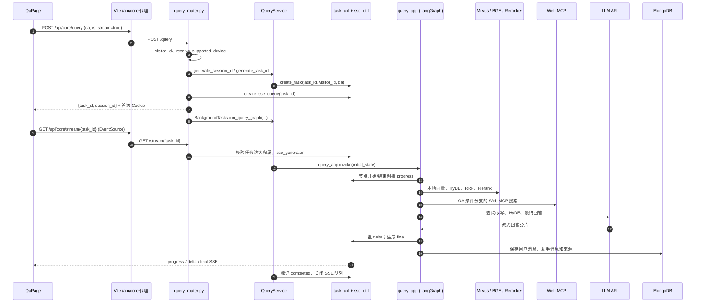

# T4-03-02 QA 请求执行链

> 盘点日期：2026-10-13。本文只追踪当前 `mode="qa"` 的真实代码路径；未启动服务、未调用 LLM，也不把前端开发预览数据当作业务结果。路径以文件和函数名定位，便于后续断点或日志排查。

## 1. 一次请求的全景

`/qa` 页面的真实请求从 `frontend/src/pages/QaPage.tsx:handleSubmit` 开始。页面先乐观地插入用户消息和空的助手消息，再发起 HTTP 请求；只有拿到 `task_id` 后才建立 SSE 连接。后端 POST 处理很短：创建访客、会话、任务和队列后即返回；LangGraph 在 FastAPI `BackgroundTasks` 中同步执行。LLM 令牌流与 HTTP 响应不是同一条连接：前者经进程内队列转为 SSE，后者只负责返回任务标识。



图中的 `BackgroundTasks` 表示 POST 返回后运行的后台任务，不是独立任务队列或持久化 worker。`query_app.invoke(...)` 和大部分节点函数均为同步调用；SSE 的异步生成器在 `sse_util.py:sse_generator` 中把阻塞的 `queue.Queue.get` 放到 executor 中等待。

## 2. 请求入口、标识与后台任务

### 2.1 前端请求与响应

| 顺序 | 实际代码 | 输入/输出与作用 |
| --- | --- | --- |
| 1 | `QaPage.tsx:handleSubmit` | 忽略空问题、开发预览和进行中的提交；生成仅供 React 列表使用的 `user-*`、`assistant-*` 消息 ID，先展示空助手气泡。 |
| 2 | `components/qa/qa-session.ts:buildQaRequest` | 构造 `{ query, session_id?, is_stream: true, device_id: "creality-k1", mode: "qa" }`。页面不会发送诊断字段。 |
| 3 | `services/printcare-api.ts:submitQuery` → `services/http.ts:apiClient.post` | 向同源 `/api/core/query` 发 JSON `POST`，`credentials: "include"` 使匿名 Cookie 能随请求带上。`vite.config.ts` 再将此前缀转发到 `http://127.0.0.1:8001/query`（除非 `VITE_CORE_API_TARGET` 覆盖）。 |
| 4 | `knowledge/api/query_router.py:query` | Pydantic `QueryRequest` 先验证 QA 必有非空 `query`；路由再通过 `resolve_supported_device` 将客户端设备 ID 限制为当前 V1 的 Creality K1。 |
| 5 | `query_router.py:_visitor_id` | 依次接受 `X-Visitor-ID`、`printcare_visitor_id` Cookie 或 query 参数；首次 QA 缺失时生成 UUID，并由 `_visitor_response` 以 `HttpOnly`、`SameSite=Lax` Cookie 返回。当前前端不主动写 `X-Visitor-ID`。 |
| 6 | `QueryService.generate_session_id` / `generate_task_id` | 未带 `session_id` 时生成 UUID；每次请求生成短 UUID hex `task_id`，并由 `task_util.py:create_task` 写入进程内状态及 `{visitor_id, mode}` 所有者信息。 |
| 7 | `query_router.py:query` 的流式分支 | **返回响应前**调用 `create_sse_queue(task_id)`，随后登记 `background_task.add_task(service.run_query_graph, ...)`，立即返回 `{ message, task_id, session_id }`。这一先建队列的顺序避免浏览器先连 `/stream` 时队列尚不存在。 |

前端收到 `session_id` 后，由 `handleSubmit` 写入 `localStorage["printcare.qa.session_id"]` 并调用 `registerQaSession` 更新 `printcare.qa.session_index`。`task_id` 只保存在当前页面的 `activeTaskIdRef` 中；它用于当前流与状态恢复，不是会话 ID。

### 2.2 后端调用表（按正常执行先后）

| 阶段 | 核心函数 / 节点 | 关键状态或副作用 |
| --- | --- | --- |
| 路由 | `query_router.py:query` | 校验 `QueryRequest`、设备和访客，创建会话/任务/SSE 队列，登记后台调用。 |
| 服务启动 | `query_service.py:QueryService.run_query_graph` | 再次校验模式与设备，任务置为 `processing`，组装初始 state 后调用 `query_app.invoke`。 |
| 图入口 | `query_process/main_graph.py:create_query_graph` → `ItemNameConfirmNode.__call__/process` | 读取同会话的历史、调用 LLM 改写问题，保留服务端已确认的 K1 `item_names`。 |
| 并行检索 | `VectorSearchNode.process`、`HyDeSearchNode.process`、`WebSearchMcpNode.process` | QA 才会调度三个分支；前两者写本地候选，第三者写网页候选。 |
| 本地融合 | `RrfNode.process` | 仅对直接向量和 HyDE 的本地命中做 RRF，写入 `rrf_chunks`。 |
| 统一精排 | `RerankNode.process` | 合并本地 RRF 候选和 QA 网页候选，重排、截断后写 `reranked_docs`。 |
| 输出 | `AnswerOutputNode.process` | 限制上下文大小、调用流式 LLM，写任务结果/来源、Mongo 历史并推送 `final`。 |
| 收尾 | `QueryService.run_query_graph` 的 `finally` | 成功置 `completed`，异常置 `failed` 并保存 `error`；流式任务总会 `close_sse_stream`。 |

`knowledge/core/deps.py:get_query_service` 使用缓存服务实例供路由注入，但每一次 QA 都创建新的 `task_id` 和初始 state。

## 3. LangGraph：真实节点顺序与 State 演变

### 3.1 图的构建与路由

`knowledge/processor/query_process/main_graph.py` 在模块导入时执行 `query_app = create_query_graph()`。函数用 `StateGraph(QueryGraphState)` 建图并 `compile()`；实际运行入口是 `QueryService.run_query_graph` 中的同步 `query_app.invoke(default_state)`，不是文件末尾仅供手工演示的 `__main__` 代码。

正常 QA 的边为：

```text
item_name_confirm
  └─ multi_search
       ├─ search_embedding      (VectorSearchNode)
       ├─ search_embedding_hyde (HyDeSearchNode)
       └─ web_search_mcp        (WebSearchMcpNode，仅 qa)
  └─ join → rrf → rerank → answer_output → END
```

`route_after_item_confirm` 有一个短路：若 `ItemNameConfirmNode` 已填入 `answer`（例如无法确认产品），QA 会直接进入 `answer_output`，跳过全部检索。当前正常前端请求已携带、且服务端会确认 `creality-k1`，所以 `item_names` 固定为 `['Creality K1']`，通常仍会进入检索；LLM 的商品抽取结果不会替换这个服务端设备归属。

`multi_search` 与 `join` 都是图内的 lambda 虚拟节点。`route_search_branches` 对 QA 返回三个节点名，因而三个检索分支可并发执行；T3 修复后的向量和 HyDE 节点仅返回各自字段增量，避免并行分支重复写入无关标量字段。

### 3.2 QA 关心的 State 字段

`knowledge/processor/query_process/state.py:QueryGraphState` 是图的字段说明。路由/服务实际传给图的是一个**部分字典**，并非调用 `create_default_state()` 得到的完整默认对象；下表只列出 QA 链中的实用字段。

| 时段 | 主要字段 | 写入者与含义 |
| --- | --- | --- |
| 进入图 | `original_query`、`session_id`、`visitor_id`、`task_id`、`is_stream`、`device_id`、`device_model`、`item_names`、`mode='qa'` | `QueryService.run_query_graph`。设备显示名和 item name 来自服务端 allowlist，而非页面自由文本。 |
| 查询确认后 | `history`、`rewritten_query`、`item_names`，或短路用的 `answer` | `ItemNameConfirmNode.process` 从 Mongo 读取近期历史，以 LLM 改写问题；有服务端设备时仍保留原来的 `item_names`。 |
| 并行搜索后 | `embedding_chunks`、`hyde_embedding_chunks`、`web_search_docs` | 三个分支各自写回自己的增量。网页结果为 `{title, url, snippet}`，不进入 RRF。 |
| 融合/精排后 | `rrf_chunks`、`reranked_docs` | RRF 只合并本地 chunk；Rerank 将可用本地/网页文本规范为带 `source_type`、`source_id` 的文档并重排。 |
| 回答后 | `prompt`、`answer`、`sources` | `AnswerOutputNode` 构造受字符预算限制的 prompt，得到完整答案，并保留真正装入 prompt 的结构化来源。 |

`task_util.py` 中另有与图 state 分离的进程内任务数据：`status`、运行/完成节点列表、`answer`、`sources`、`error`。`/status/{task_id}` 从这里读取；它不是 MongoDB，服务重启后会消失。

## 4. RAG 的当前代码路径

### 4.1 查询确认与历史上下文

`ItemNameConfirmNode.process` 调用 `mongo_history_util.py:get_recent_messages(session_id, visitor_id)` 读取最近消息，并将其传给 `ItemNameExtractor.extract_item_name`。后者经 `AIClients.get_llm_openai()` 请求 JSON 格式的 LLM 输出，解析出 `rewritten_query` 和候选产品名。

对当前 K1 页面，这一节点的实际重点是**结合历史改写问题**：因为服务初始 state 已含 `device_id` 与 `item_names=['Creality K1']`，其 `_decide` 会使用该固定名称，不会再调用 `ItemNameAligner` 的产品名向量匹配。它还会把读到的 Mongo 历史写到 `state['history']`，供最后的回答 prompt 使用。

### 4.2 两路本地混合检索

| 分支 | 实际实现 | 产物 |
| --- | --- | --- |
| 直接检索 | `nodes/vector_search.py:VectorSearchNode.process` 用 `AIClients.get_bge_m3_client` 对 `rewritten_query` 生成 BGE-M3 的稠密和稀疏查询向量；`milvus_util.py:create_hybrid_search_requests` 创建 dense `COSINE` 与 sparse `IP` 两个 `AnnSearchRequest`，`execute_hybrid_search_query` 用 `WeightedRanker(0.5, 0.5)` 查询。 | 最多 5 个命中，写入 `embedding_chunks`。 |
| HyDE 检索 | `nodes/hyde_search.py:HyDeSearchNode.process` 先经文本 LLM 生成假设性技术文档，再将“改写问题 + 假设文档”用同一 BGE-M3 混合编码并查询。 | 最多 5 个命中，写入 `hyde_embedding_chunks`。 |

两路均通过 `milvus_util.py:item_names_filter` 生成 Milvus 表达式：`device_id == ... and item_name in ...`。这是在 Milvus 检索前施加的服务端设备/名称过滤，不是回答 prompt 的软约束。Milvus 返回的字段包括 `chunk_id`、`content`、标题、文件标题、设备 ID/显示名等。

`RrfNode.process` 去掉 Milvus 命中包装层的 `entity`，以 `chunk_id` 去重并按 `weight / (rrf_k + rank)` 合并两路排名。当前默认 `rrf_k=60`、最多保留 10 条（见 `query_process/config.py`）；**Web MCP 结果不会参与此 RRF**。

### 4.3 QA 专用 Web MCP 与统一 Rerank

`route_search_branches` 只有在 `mode == 'qa'` 时调度 `WebSearchMcpNode`。节点也在 `process` 的第一步重复判断模式，非 QA 会在创建 MCP 客户端前返回空增量。QA 情况下，`WebSearchMcpNode._create_execute_web_search` 以 `MCPServerStreamableHttp` 调用 `bailian_web_search`（`count=3`），解析 `title`、`url`、`snippet` 写到 `web_search_docs`。

`RerankNode.process` 才把两类候选合并：本地 RRF 文档被规范为 `source_type='local'`、`source_id='chunk:<chunk_id>'`；QA 网页结果被规范为 `source_type='web'`、`source_id=<url>`。随后用 `AIClients.get_bge_m3_rerank_client()` 的 `FlagReranker.compute_score` 对 `(rewritten_query, document.content)` 对打分，sigmoid 归一化、按分数排序，再按配置的最小/最大数量与分数“断崖”截断。网页结果与本地资料会一起竞争最终上下文，不应把 QA 的网页来源误读为 K1 本地知识库资料。

### 4.4 最终 prompt、答案与来源

`AnswerOutputNode.process` 调用 `_build_prompt`。`_format_context_sources` 按 `MAX_CONTEXT_CHARS`（默认 12000）依次装入 `reranked_docs`，达到预算即停止；同时为**实际装入**的资料生成 `sources`，字段为：

```text
source_type: local | web
source_id:   chunk:<Milvus chunk_id> | 网页 URL
title / section_title / excerpt / url（适用时）
```

这不是模型逐句声称的引用，而是“进入本次生成上下文的资料片段”记录。`_format_chat_history` 再用剩余预算附加同会话的历史，然后以 `ANSWER_PROMPT` 组装最终文本 LLM prompt。

流式 QA 走 `_generage_answer` → `_stream_generate`，调用 `llm_client.stream(prompt)`；每个非空 `chunk.content` 立即累加到 `state['answer']` 并推送一个 `delta`。完成后完整答案被写到 `task_util.set_task_result(task_id, 'answer', ...)`。无论流式或非流式，`_write_history` 都尝试把用户原问题及助手完整回答写入 Mongo，并把结构化 `sources` 仅附在助手消息上。

## 5. SSE：事件如何到达页面，以及断开时的现状

### 5.1 建连与事件来源

前端在拿到 `task_id` 后调用 `services/sse.ts:subscribeToTask`，建立同源 `EventSource('/api/core/stream/{task_id}')`。同源请求经 Vite 代理，浏览器会携带上一段 POST 取得的匿名访客 Cookie。

后端 `query_router.py:stream` 先确认 `task_exists(task_id)`，再由 `_require_task_visitor` 比较任务内存中的访客 ID 与本次请求访客 ID；不匹配时统一 404，避免泄露其他访客的任务存在性。校验通过才返回 `StreamingResponse(sse_generator(...), 'text/event-stream')`。

| SSE 事件 | 生产位置 | 页面处理 |
| --- | --- | --- |
| `progress` | 每个 `BaseNode.__call__` 在节点开始和完成时调用 `_push_progress`；载荷为当前任务 `status`、`running_list`、`done_list`。 | `QaPage.tsx:onProgress` 用 `describeProgress` 更新页面进度文字。 |
| `delta` | `AnswerOutputNode._stream_generate` 对每个 LLM 文本分片调用 `push_sse_event`。 | `onDelta` 调用 `appendAssistantDelta`，把文本追加到预建的空助手消息；同时安排状态恢复轮询。 |
| `final` | `AnswerOutputNode.process` 在历史写入后推送完整 `answer` 与 `sources`。 | `onFinal` 用完整回答替换增量文本、转换来源、结束任务并关闭 EventSource。`ConversationMessage` 随后通过 `SourceReferences` 展示本轮上下文来源。 |
| `error` | `SSEEvent.ERROR` 已定义，诊断服务会使用；**当前 QA 的 `QueryService.run_query_graph` 异常分支没有推送该事件**，只写任务内存 `error`、置 `failed` 并关闭流。 | `onTaskError` 已存在，但对该 QA 主路径通常不会收到事件；实际恢复主要依赖网络关闭后读取 `/status`。 |

`sse_util.py:sse_generator` 从全局 `_task_stream[task_id]` 的 `queue.Queue` 取事件，封成 `event: ...\ndata: ...`，并在连接结束的 `finally` 中移除队列。`QueryService.run_query_graph` 不论成功或失败都会在 `finally` 入队关闭标记。任务表和队列均为单个 Python 进程内存：进程重启、多个实例间路由变化或队列已被移除时，`/status`、`/stream` 都不能用它们恢复。

### 5.2 前端中断与状态恢复

- `subscribeToTask` 在任何已监听事件后重置 30 秒无事件计时器；超时或浏览器 `EventSource.onerror` 时关闭连接并调用 `onNetworkError`。这是客户端超时回收，不是已完成活跃流物理断连恢复的真实验收。
- `QaPage.tsx:recoverTask` 调用 `GET /api/core/status/{task_id}`：若已有 `answer`，用任务内存中的完整答案和来源替换页面内容；若有 `error`，展示错误；两者都没有则提示结果尚不可用。
- 每收到一个 `delta`，`scheduleStatusFallback` 会在 4 秒后检查状态；未完成时最多再安排 3 次。这是静默流停滞的补救，不会重连或重放已错过的 SSE delta。
- 组件卸载或“新建问答”只会关闭当前 EventSource、取消页面 HTTP 请求并清理本地当前会话选择；不会取消已经在后端运行的图任务。

## 6. 持久化、刷新恢复与访客边界

### 6.1 MongoDB 中保存什么

`mongo_history_util.py:save_chat_message` 写入 `chat_message` 集合。每条 QA 消息至少包含 `session_id`、`visitor_id`、`role`、`text`、`rewritten_query`、`item_names`、`ts`；助手消息还可带 `sources`。`AnswerOutputNode._write_history` 的顺序是先写用户消息，再在有完整答案时写助手消息；写入异常仅记录 warning，不会使已生成的回答自动失败。

读取路径为：`GET /history/{session_id}` → `query_router.py:get_history` → `QueryService.get_history` → `get_recent_messages`。Mongo 查询条件同时包含 `session_id` 和 `visitor_id`，按时间倒序取最近 N 条后在内存中恢复为旧到新的顺序。路由调用 `_visitor_id(..., allow_create=False)`，所以没有访客标识不能读取；服务端而非前端负责最终归属校验。

### 6.2 页面如何恢复

`QaPage.tsx` 初次挂载时读取 `localStorage["printcare.qa.session_id"]`，再请求该会话的 `/history/{session_id}`，由 `historyToQaMessages` 把 Mongo 项目还原为页面消息和来源。这只恢复“当前选中的一个 QA 会话”。

`HistoryPage.tsx:loadRecords` 处理多会话展示：它读取浏览器 `printcare.qa.session_index`（及当前 session 作为补充），对每个已登记 ID 分别调用 `/history/{session_id}`。后端当前没有按访客列举全部 QA 会话的 API，因此同一访客的 Mongo 记录即使仍存在，只要该浏览器本地索引丢失，也不会自动出现在 QA 历史列表中。匿名 Cookie 和本地索引都具有浏览器边界，不能承诺跨设备同步。

开发环境 `?preview=...` 的 `QaPage` 与 `HistoryPage` 包含模拟消息/来源，仅用于视觉状态；这些分支不调用上述 API，不能作为真实请求链或来源展示的依据。

## 7. 典型问题的代码级走读

以用户在 `/qa` 输入“**K1 首层无法附着怎么办？**”为例：

1. `handleSubmit` 通过 `buildQaRequest` 发送 K1 固定设备、当前 `session_id`（若是首问则缺省）、`is_stream=true` 和 `mode=qa`；页面立即显示用户问题与空助手气泡。
2. `query_router.py:query` 校验问题、解析或创建匿名访客 Cookie、生成会话与任务 ID、建 SSE 队列并返回。这一步尚未完成检索或生成。
3. 后台 `QueryService.run_query_graph` 将任务标为 `processing`，把“原问题、会话、访客、K1 设备/名称、任务、流式标志”传入 `query_app.invoke`。
4. `ItemNameConfirmNode` 从该访客的同会话 `chat_message` 取上下文，LLM 可把“首层无法附着”改写得更完整，但 K1 设备名称仍以服务端 state 为准。
5. 直接向量分支和 HyDE 分支各在 Milvus K1 范围中执行稠密+稀疏混合查询；Web 分支另以改写问题请求最多三个网页候选。RRF 只融合前两路本地候选。
6. Reranker 对“本地 RRF + 网页”文本按相关性排序并截断。`AnswerOutputNode` 只将没超过字符预算的文档放进 prompt，随之得到准确对应的 `sources` 列表。
7. LLM 输出的每个分片从 `_stream_generate` 变成 `delta`，页面持续追加；完整文本、来源写入任务内存和 Mongo 后，`final` 让前端替换成最终版本并显示来源卡片。最后服务层把任务标为 `completed` 并关闭流。

## 8. 失败点与排查入口

| 现象 | 首先检查的真实入口 | 当前行为/限制 |
| --- | --- | --- |
| POST 立即 422 或前端请求失败 | `query_schema.py:QueryRequest.validate_mode_payload`、`core/devices.py:resolve_supported_device`、`http.ts:ApiError` | 空问题或不支持设备会在图前失败；网络失败会映射为前端通用网络错误。 |
| POST 成功但 SSE 404 | `query_router.py:stream`、`_require_task_visitor`、`task_util.py:task_exists` | 任务不存在/已失效、不同访客 Cookie 或服务重启均可能导致 404。 |
| 一直显示处理中 | `sse.ts:subscribeToTask`、`QaPage.tsx:recoverTask`、`/status/{task_id}` | 前端有 30 秒无事件回收和有限状态轮询；进程内任务信息丢失时无法恢复。 |
| 无本地检索结果或结果越界 | `VectorSearchNode.process`、`HyDeSearchNode.process`、`milvus_util.py:item_names_filter` | 检查 BGE 客户端、Milvus collection 和 `device_id + item_name` 过滤；不要先把问题归因为 prompt。 |
| Web 结果为空或慢 | `WebSearchMcpNode.process` / `_create_execute_web_search` | 仅 QA 调用；MCP 请求的工具、超时、重试和返回 JSON 解析均在该节点。网页为空不阻止后续本地链继续。 |
| 没有答案或来源 | `RerankNode.process`、`AnswerOutputNode._format_context_sources`、`_stream_generate` | Rerank 可返回空候选；来源只包含实际进入字符预算的文档。流式 LLM 内部异常会被 `_stream_generate` 记录后返回已累积文本，需同时查看任务状态和服务日志。 |
| 页面有答案但刷新后无历史 | `AnswerOutputNode._write_history`、`mongo_history_util.py`、浏览器 localStorage | Mongo 写入失败在当前实现中仅 warning；或当前 session/local 索引被清除。读取还受 `visitor_id` 过滤。 |
| 任务失败但页面未收到明确错误事件 | `QueryService.run_query_graph`、`sse_util.py`、`QaPage.tsx:recoverTask` | QA 异常只写内存 `error` 后关流，不显式 `push_sse_event(..., ERROR, ...)`；应检查 `/status` 与后端日志。 |

## 9. 与 T4-03-01 的一致性及未确认范围

本次逐节点核对未发现需要改写 [T4-03-01 系统架构与模块职责](T4-03-01-系统架构与模块职责.md) 的架构性差异。需要特别避免的误解是：QA 的 `error` SSE 监听存在，不等于当前 QA 异常路径会实际发送该事件；以及 `task_id`/SSE 队列可恢复历史。两者都只属于当前服务进程。

本文未验证外部 LLM/MCP/Milvus 的实时可用性、检索质量、浏览器在活跃流中发生物理断连后的恢复，也未执行真实请求。下一步若分析 Diagnosis，应从 `knowledge/services/diagnosis_service.py`、`diagnosis_context.py`、诊断决策/验证节点和 `diagnosis_session_util.py` 独立追踪，不能从本 QA 流程推断其持久化和错误语义。
