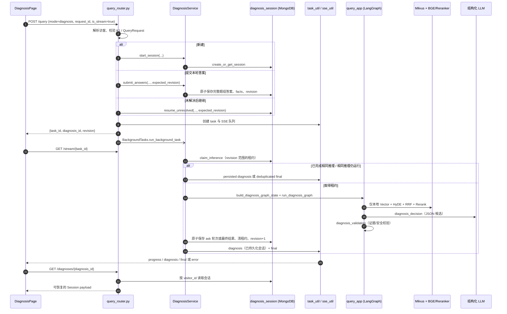
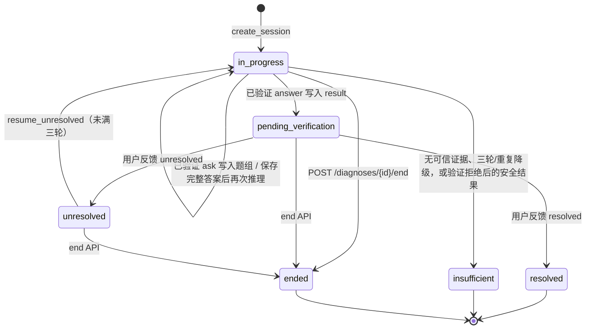

# T4-03-03 Diagnosis 请求执行链

> 盘点日期：2026-10-13。本文依据当前源码追踪 `mode="diagnosis"`；未启动服务、未调用真实 LLM。文中的“强制”指 Pydantic、路由、Mongo 原子条件或服务端校验；模型 Prompt 是约束说明，不等同于已验证的模型行为。

## 1. 诊断请求的总体协作

Diagnosis 使用与 QA 相同的 `/query` 和 SSE 入口，但不会把诊断当作自由文本回答：路由先持久化会话变更，`DiagnosisService` 再取得 Mongo 推理租约、调用共用 LangGraph；只有经过证据校验且写回 Mongo 的结果才会发给页面。页面收到诊断 SSE 后仍以 `GET /diagnoses/{id}` 的持久化状态为准。



浏览器到服务的 `/api/core` 前缀由 `frontend/vite.config.ts` 转发至查询服务 8001；HTTP 请求使用 `credentials: "include"`，同源 `EventSource` 也携带匿名访客 Cookie。任务表和 SSE 队列仍是当前查询服务进程内存，MongoDB 的诊断会话才是刷新和 SSE 中断后的恢复依据。

## 2. 页面、请求字段与会话创建

### 2.1 三类图执行请求

`frontend/src/components/diagnosis/diagnosis-session.ts` 是页面构造诊断请求的唯一辅助层，`DiagnosisPage.tsx:submitDiagnosis` 通过 `printCareApi.submitQuery` 发送它们：

| 操作 | 构造函数与关键字段 | 路由实际操作 |
| --- | --- | --- |
| 新建 | `buildDiagnosisStartRequest(problem, requestId)`：`mode='diagnosis'`、`is_stream=true`、`device_id='creality-k1'`、`original_problem`、`request_id` | `query_router.py:query` 调用 `DiagnosisService.start_session` → `DiagnosisSessionRepository.create_or_get_session`，并将推理请求命名为 `start:<request_id>`。 |
| 提交一轮批量回答 | `buildDiagnosisAnswerRequest(session, answers, requestId)`：`diagnosis_id`、完整 `answers`、`request_id`、`expected_revision=session.revision` | 路由调用 `DiagnosisService.submit_answers`，先把本轮回答原子写入 Mongo；随后以新 revision 启动 `continue:<request_id>` 推理。 |
| 未解决后继续 | `buildResumeUnresolvedRequest(session, requestId)`：`diagnosis_id`、`request_id`、`expected_revision`、`resume_unresolved=true` | 路由调用 `repository.resume_unresolved`，把会话从 `unresolved` 恢复为 `in_progress`、清空旧 result，再以新 revision 启动 `resume:<request_id>` 推理。 |

`QueryRequest.validate_mode_payload` 强制：所有诊断请求均有非空 `request_id`；新建必须有问题和设备；续接必须有 `diagnosis_id`、`expected_revision` 与至少一个答案；恢复不能同时提交答案。路由还会经 `resolve_supported_device` 把新建时的设备限制为 V1 的 `creality-k1`。这些是服务端契约，前端固定 K1 不是唯一防线。

页面的 `getRequestId` 为同一“操作键”缓存 `crypto.randomUUID()`；这样一次按钮重试会使用相同 ID，而非重复提交。`DiagnosisQuestionGroup` 也会在前端要求选中当轮每一道题，支持选择 `uncertain`/`other`，并仅在选 `other` 时显示补充说明框。服务端仍会再次检查问题集合和选项 ID，不能用前端校验替代。

### 2.2 首次响应与页面恢复

诊断流式 POST 的成功响应为 `{task_id, diagnosis_id, revision, message}`，没有把模型结论直接放进 POST 响应。`submitDiagnosis` 随即：

1. 将 `diagnosis_id` 写入 `localStorage['printcare.diagnosis.id']`；
2. 先调用 `recoverPersistedSession`（`GET /diagnoses/{id}`）读取当前 Mongo 会话；
3. 再由 `subscribe(taskId, diagnosisId)` 建立 SSE。

因此，在后台图尚未写出第一轮问题前，页面可能是 `in_progress + decision=null` 的恢复/处理中状态；它不会把未持久化的模型文本显示为结果。页面加载时也会读取该 localStorage ID；若服务端返回 404 则移除本地 ID，其他读取失败显示恢复错误。

## 3. LangGraph：本地检索、动态决策与校验

### 3.1 进入共用图的 State

`DiagnosisService._run_turn` 调用 `QueryService.build_diagnosis_graph_state`。它先由 `DiagnosisSessionRepository.get_session` 读取**当前访客拥有的**会话，再调用 `DiagnosisContextAssembler.assemble`，将原始问题、服务端 K1 设备、已保存问题/答案组成受限检索文本，最后建立下列核心 state：

| State 字段 | 来源和用途 |
| --- | --- |
| `original_query` | Mongo 的 `original_problem`，供决策 Prompt 展示。 |
| `rewritten_query` | `DiagnosisContextAssembler._build_retrieval_query` 生成，包含设备、原始问题、已确认事实和未确认回答，最长 4000 字符；供向量与 HyDE 检索。 |
| `diagnosis_facts` | 只保留能对应当前轮有效选项、且 `option_type='normal'` 的已确认事实。 |
| `diagnosis_answer_history` | 所有有效已答题（含 `uncertain`/`other`），并标记为 `confirmed` 或 `unconfirmed`。 |
| `clarification_count` / `diagnosis_status` | Mongo 已持久化轮次/状态；决策节点和保存动作以它限制追问。 |
| `device_id`、`device_model`、`item_names` | 由服务端设备注册表重建为 K1，不能由客户端续接请求覆盖。 |
| `task_id` / `is_stream` / `visitor_id` / `mode='diagnosis'` | 任务事件、SSE 与访问归属所需字段。 |

`DiagnosisContextAssembler` 不把最后一次选项孤立地当作检索问题：它只接受已经保存、问题 ID/选项 ID 与该轮题目匹配的回答；未知/其他回答会留在历史中但不会成为“已确认事实”。Mongo `facts` 是便利的反规范化字段，组装器会再用 `rounds` 验证它与有效回答一致。

### 3.2 实际图分流与证据链

图由 `knowledge/processor/query_process/main_graph.py:create_query_graph` 构建并编译为全局 `query_app`。`route_after_item_confirm` 和 `route_after_rerank` 依据 `mode` 分流；诊断的正常路径为：

```text
item_name_confirm
  → multi_search
      ├─ VectorSearchNode（本地 Milvus 混合检索）
      └─ HyDeSearchNode（LLM 假设文档 + 本地 Milvus 混合检索）
  → join → RrfNode（两个本地分支） → RerankNode（仅本地候选）
  → DiagnosisDecisionNode → DiagnosisValidationNode → END
```

`ItemNameConfirmNode.process` 发现诊断 state 已有 `rewritten_query` 时直接保留这份服务端组装的上下文，避免通用 QA 改写把上下文缩减为一条选项。向量与 HyDE 节点均用 BGE-M3 稠密/稀疏混合查询，并通过 `milvus_util.py:item_names_filter` 在 Milvus 请求中强制 `device_id == ... and item_name in ...`。

Diagnosis 不会调用 Web MCP 有两道程序边界：

1. `route_search_branches` 在 `mode='diagnosis'` 时只返回向量与 HyDE 两个节点；
2. 即使 Web 节点被意外直接调用，`WebSearchMcpNode.process` 也会在创建 MCP 客户端前对非 QA 返回 `{}`；`RerankNode._merge_multi_source__docs` 同样只在 QA 模式合并 `web_search_docs`。

这不是依赖 Prompt 的约定。诊断 Prompt 中的“不可使用网页”是额外模型约束；真正的检索来源隔离由上述路由、节点前置返回和重排合并条件执行。

### 3.3 决策候选：模型能做什么，程序限制什么

`DiagnosisDecisionNode.process` 先用 `build_trusted_evidence(reranked_docs, device_id)` 过滤可引用资料；没有可信本地证据时，不调用模型，直接给出 `insufficient` 候选。否则将可信来源的 `source_id`、标题、内容（同样受 `MAX_CONTEXT_CHARS` 预算限制）以及会话事实/历史/轮数装入 `DIAGNOSIS_DECISION_USER_TEMPLATE`，调用 JSON 模式 LLM。

模型输出先由 `TypeAdapter(DiagnosisDecision)` 按 `diagnosis_schema.py` 校验形状：

- `ask`：1–3 题，每题 2–4 个唯一选项，且至少一条证据；
- `answer`：结论、结论证据、至少一条带证据建议、全局 references 和安全提示；
- `insufficient`：原因、可选确认事实和至少一项后续步骤。

节点的本地强制逻辑还会检查 `ask` 不超过 `MAX_CLARIFICATION_ROUNDS=3`、规范化后不重复问已答问题。候选结构或证据格式可修复错误时，会把服务器错误码附到 Prompt 后最多再尝试一次（总计最多两次）；重复追问或三轮后仍要 `ask` 会安全降级为 `insufficient`。LLM 调用/JSON 连续失败则置 `diagnosis_status='system_error'`，不产生可保存结论。

Prompt 还要求逐字复制 `excerpt`/`support_text`、不使用常识、不要把不确定选项当事实、危险操作须带安全条件。这些能引导模型，但不能单独保证合规；下一节点再次验证。

### 3.4 验证节点与持久化门槛

`DiagnosisValidationNode.process` 重新解析候选，并重新调用 `build_trusted_evidence`，随后执行 `validate_diagnosis_candidate`。可信证据必须同时满足：

- `source` 和 `source_type` 均为 `local`，设备 ID 正确，显示型号/物品名称不与 K1 冲突；
- 有真实 `chunk_id`、非空内容，且 `source_id` 精确等于 `chunk:<chunk_id>`；
- 同一来源的冲突重复记录会被排除。

对 `ask`，每条证据摘录必须能在本轮真实 chunk 中找到，`support_text` 必须是摘录中非通用的连续片段，且问题与摘录存在具体重叠。对 `answer`，结论和每条建议都必须链接到本轮可信来源、引用关系一致，支持片段要出现在对应文本中；拆机、电气、高温、更换等风险操作还必须在建议及同一资料片段中具备操作依据和适用安全条件，且不能违反原文禁止语。对 `insufficient`，后续步骤不得夹带高风险或无依据的维修操作。

验证通过时写 `diagnosis_validated`、`diagnosis_validation_passed=true`、状态 `validated`。验证拒绝不会保留模型的 `answer`/`ask`：节点改写为安全 `insufficient`，状态为 `validation_rejected` 并保留拒绝码。`DiagnosisService._run_turn` 只允许：通过验证的 `ask` 写入问题轮；通过验证的最终结果写入；或验证拒绝后形成的 `insufficient` 写入并附拒绝元数据。系统错误、缺少候选、或被拒绝的维修结论均不会被当作诊断结果保存。

## 4. Mongo 会话、幂等与并发控制

### 4.1 `diagnosis_session` 的持久化模型

`knowledge/utils/diagnosis_session_util.py:DiagnosisSessionRepository` 管理独立 Mongo 集合 `diagnosis_session`，不复用 QA 的 `chat_message`。创建文档的核心字段如下：

| 字段 | 作用 |
| --- | --- |
| `diagnosis_id`、`visitor_id`、`device_id`、`device_model`、`original_problem` | 稳定会话身份、匿名归属和服务端设备范围。 |
| `status`、`revision`、`clarification_count` | 生命周期、乐观并发版本和已持久化追问次数。初始为 `in_progress`、0、0。 |
| `rounds` | 每轮 `round_index`、服务器验证过的问题/选项、用户批量 answers、创建/答题时间。 |
| `facts` | 已提交答案的反规范化记录；检索前仍需由 `rounds` 二次核对。 |
| `result`、`result_metadata`、`feedback` | 已验证的最终 `answer`/`insufficient`、验证拒绝说明、用户反馈。 |
| `execution` | Mongo 推理租约：请求 ID、revision、起止时间、可选 task ID；不是诊断结论。 |
| `processed_requests`、`creation_request_id` | 创建、答题和推理的幂等记录。 |

`ensure_indexes` 建立 `diagnosis_id` 唯一索引、按 `visitor_id + updated_at` 的列表索引，以及 `visitor_id + creation_request_id` 的局部唯一索引。这使相同访客的并发“首次创建”也只能产生一个会话。

### 4.2 `request_id`、revision 和租约分别解决什么

| 机制 | 主要代码 | 解决的具体问题 |
| --- | --- | --- |
| 创建幂等 | `create_or_get_session` + 创建请求唯一索引 | 网络重试或并发点击同一新建请求时，复用同一诊断会话。 |
| 答题幂等 | `save_answers` 先查/再在原子过滤中排除同一 `processed_requests.request_id` | 同一批答案重复到达时返回现有会话，不重复写 answers、facts 或推进 revision。 |
| 乐观并发 | 所有修改条件包含 `revision=expected_revision`；`_require_expected_revision` / `_raise_after_failed_write` | 页面过期、另一标签页或并发提交已推进版本时抛 `DiagnosisSessionConflictError`，路由映射 HTTP 409。前端收到 409 会重新读取会话而非猜测覆盖。 |
| 推理租约 | `claim_inference` 的 `execution` 原子设置，默认 300 秒；`release_inference` | 同一 revision 不能并行运行两次图。相同推理请求可识别为运行中或已完成；不同请求遇到未过期租约冲突。进程崩溃后过期租约可被下一请求回收。 |

每个实际保存动作都把 `revision` 加一：保存问题组、保存完整答案、保存最终结果、反馈和恢复未解决会话皆如此。`save_answers` 除版本外还强制提交的问题 ID 集合等于当前未答题组，且每个 option ID 属于对应问题；`save_question_round` 在 Mongo 更新过滤条件里再次要求 `clarification_count < 3`，避免两个调用者都在预读后写出第四轮。

`claim_inference` 成功后，图会以该 revision 执行；`save_question_round` 或 `save_final_result` 的原子更新必须匹配同一 `execution.request_id`，并在成功时清除租约、写入推理请求记录。图/校验失败时服务调用 `release_inference`，会话 revision 不前进，因此用户能在保持一致的状态下安全重试。

## 5. 会话状态转换与结果反馈

### 5.1 实际状态图



`save_final_result` 将 `answer` 写为 `pending_verification`，绝不会自动标为 `resolved`；`insufficient` 直接为终态。`set_feedback` 仅允许从 `pending_verification` 到 `resolved` 或 `unresolved`。`unresolved` 故意不是 `TERMINAL_STATUSES`，可以由 `resume_unresolved` 在轮数少于 3 时重新进入诊断；该恢复会清空 `result`/`result_metadata`，但当前实现不会清空已有 `feedback` 字段，产品层是否需要隐藏或重置旧反馈需后续确认。

路由另提供 `POST /diagnoses/{id}/end`，按状态转换表结束会话；`printCareApi.endDiagnosis` 已封装，但当前 `DiagnosisPage.tsx` 未调用它，页面可见的“重新描述问题”只清除浏览器当前选择和本地 ID，不会向后端发送 end 或删除会话。

### 5.2 SSE、持久化和刷新

`DiagnosisService.run_task` 会先把进程内 task 标为 `processing`。它自行推送 `retrieval`、`decision`、`validation` 三个进度，图中继承 `BaseNode` 的节点也会推送节点开始/完成进度。关键顺序是：

1. `_run_turn` 成功写入 Mongo 后，`session_payload` 才由 `decision_from_session` 取出问题组或 result；
2. 流式时才推 `SSEEvent.DIAGNOSIS`，因此此事件的 `decision` 已持久化；
3. 再将 task 标为 `completed`（或请求去重时 `deduplicated`）并推 `final`；最后关闭队列。

前端的 `onDiagnosis` 直接替换页面 session；`onFinal`、`onTaskError`、网络错误或 30 秒无事件超时都会调用 `recoverAfterStreamIssue` → `GET /diagnoses/{id}`，以 Mongo 最新状态覆盖页面。和 QA 不同，Diagnosis 不以 `/status/{task_id}` 作为主要恢复来源。若会话仍 `in_progress`、没有 decision 且没有 `execution` 租约，`viewForSession` 呈现“本次诊断未完成”的安全恢复界面，不把它伪装成结论。

若图失败，`run_task` 将 task 标为 `failed`，推 `error` 和失败 `final`，并由 `_run_turn` 释放 Mongo 租约；这与 QA 当前失败路径不发送显式 error SSE 不同。无论如何，SSE 队列、任务状态和活动 task ID 都只在当前 Python 进程有效；Mongo 的会话、轮次、反馈、revision 和租约才有重启后的持久化保证。

### 5.3 History、删除和反馈 UI

- `GET /diagnoses` → `DiagnosisSessionRepository.list_sessions(visitor_id)` 返回当前匿名访客最近更新的会话；`GET /diagnoses/{id}` 读取单会话，均用 `diagnosis_id + visitor_id` 查询。
- `HistoryPage.tsx:loadRecords` 调用 `printCareApi.listDiagnoses`，详情再调用 `getDiagnosis`；它显示持久化轮次、答案、决策和反馈。
- History 删除调用 `DELETE /diagnoses/{id}` → `delete_session`，Mongo 的删除条件同样包含访客 ID；不同访客不会删除到对方记录。
- `DiagnosisResult.tsx` 只有在 `pending_verification` 显示“已解决 / 未解决”按钮，调用 `DiagnosisPage.handleFeedback` → `/diagnoses/{id}/feedback`，并以返回会话替换页面。`unresolved` 时展示“请求继续诊断”。

## 6. 一个典型动态诊断过程

以“**K1 第一层无法稳定附着**”为例，正常的代码级过程如下：

1. `handleStart` 生成 `start:<随机 UUID>` 的前端请求 ID，发起新建；Mongo 创建 revision 0、无轮次、`in_progress` 的会话。
2. 后台任务取得 revision 0 的租约，`DiagnosisContextAssembler` 以原始描述和 K1 资料范围生成检索 query。共用图仅检索 K1 的本地 chunk；若出现网页结果也会在诊断 Rerank 合并前被排除。
3. 假定本轮命中可信资料，`DiagnosisDecisionNode` 让 LLM 选择 `ask`、`answer` 或 `insufficient`。若返回合规的一到三道 `ask`，验证节点核验每题证据，`save_question_round` 持久化第一轮空 answers，`clarification_count=1`、`revision=1`，再发送已持久化 session。
4. 用户为同一轮每题选择选项后，页面在 `handleAnswerSubmit` 用 revision 1 和新的 `request_id` 提交。`save_answers` 原子保存**完整题组** answers/facts，revision 先推进至 2；之后图以 revision 2 重新检索，其中 normal 选项是确认事实，uncertain/other 只作为未确认上下文。
5. 图可再安全地 `ask`，也可提前返回已验证的 `answer`（不必凑满三轮）或 `insufficient`。三轮只是 `ask` 上限，不是必须轮数。若最终 `answer` 保存，revision 再推进且状态为 `pending_verification`，由用户明确反馈才到 `resolved`/`unresolved`。

这里“模型决定问什么”是动态的；“最多三轮、问题/选项数量、只能引用本轮可信 K1 本地证据、持久化前必须验证、不能自动解决”则由代码强制。

## 7. 测试、真实验收和未替代的缺口

仓库已有针对性自动化：`knowledge/test/test_diagnosis_schema.py`（结构契约）、`test_diagnosis_context.py`（历史组装）、`test_diagnosis_decision.py`（轮数、重复问题、有限重试）、`test_diagnosis_validation.py`（来源/风险安全）、`test_diagnosis_session_repository.py` 与 `test_diagnosis_session_mongo_integration.py`（原子更新、租约、冲突）、`test_diagnosis_api.py`（路由/持久化/SSE 合约）；前端还有 `diagnosis-session.test.ts`、`diagnosis-state.test.ts` 与 `sse.test.ts`。本文仅盘点，未重跑这些测试。

`docs/T2-07-真实业务验收.md` 记录较早基线曾以真实 LLM 完成 `answer → pending_verification → resolved/unresolved`（含 `unresolved` 后恢复）；这不能替代当前版本回归。`docs/T3-03-06-端到端验收.md` 记录的当前 K1 诊断已验证动态 `ask`、批量回答、`insufficient`、刷新/History、旧 revision 409 与相同 `request_id` 幂等；但当轮真实模型未产出可验收的 `answer`。因此 `answer → pending_verification → resolved/unresolved` 的**前端到真实服务**回归仍为 Not Run，不能以上述单元测试、API 测试或前端预览 Fixture 宣称通过。活跃 SSE 的真实物理断连恢复也仍是 Not Run。

## 8. 失败场景与源码排查入口

| 表现 | 首先检查 | 当前安全行为 |
| --- | --- | --- |
| 新建/续接返回 422 | `query_schema.py:QueryRequest.validate_mode_payload`、`diagnosis_schema.py`、`core/devices.py:resolve_supported_device` | 在图和任务创建前拒绝缺字段、非法设备、缺 request ID 或不完整答案。 |
| 提交旧页面数据返回 409 | `DiagnosisSessionRepository._require_expected_revision`、原子更新过滤条件、`query_router.py:_diagnosis_http_error` | 不写入旧答案；前端 `submitDiagnosis`/`handleFeedback` 读取最新会话后让用户继续。 |
| 同一操作重复点击 | `DiagnosisPage.getRequestId`、`create_or_get_session`、`save_answers`、`claim_inference` | 相同请求 ID 尽量复用会话/结果或标记运行中的 task，不应重复推进 revision。 |
| 一直处理中或刷新后无结果 | `session_payload` 的 `processing`、`execution` 租约、`DiagnosisPage.viewForSession` | 有租约时显示处理中；无租约也无 decision 时显示未完成恢复界面，而不是成功结论。 |
| 没有可用证据 / 引用被拒绝 | `build_trusted_evidence`、`validate_diagnosis_candidate`、`DiagnosisValidationNode.process` | 无证据直接 `insufficient`；无效候选降级为安全 `insufficient`，不保存无依据 answer。 |
| 模型 JSON/传输失败 | `DiagnosisDecisionNode.process`、`DiagnosisService._run_turn` | 有限重试后标记 system error，释放租约；不会把失败写成结论。 |
| 已开始 SSE 后断开 | `services/sse.ts`、`DiagnosisPage.recoverAfterStreamIssue`、`GET /diagnoses/{id}` | 客户端 30 秒看门狗/网络错误后读取 Mongo；真实物理断连恢复尚未端到端验收。 |
| 页面“重新描述问题”后又出现旧会话 | `DiagnosisPage.resetToStart`、`getRequestId`、`create_or_get_session` | `resetToStart` 不清空组件内 request ID Map；在同一页面生命周期内用完全相同原始描述再次新建会复用 start 请求 ID，可能取回旧会话。该交互意图尚未通过真实场景确认。 |

## 9. 与前序架构文档的关系与未确认事项

本次代码追踪未发现需要改写 [T4-03-01 系统架构与模块职责](T4-03-01-系统架构与模块职责.md) 或 [T4-03-02 QA 请求执行链](T4-03-02-QA请求执行链.md) 的架构性差异；本报告进一步确认 Diagnosis 的 SSE 只发布持久化会话，而不是候选 LLM 文本。

尚未通过本轮只读检查确认的行为包括：外部 LLM 在真实 K1 资料下稳定产生可通过严格验证的 `answer` 的比例；租约过期后的实际生产恢复体验；以及上表所列“重置后相同原始描述复用请求 ID”是否符合产品预期。它们应在后续有明确授权的真实联调/验收中验证，而不应由文档或预览状态替代。
